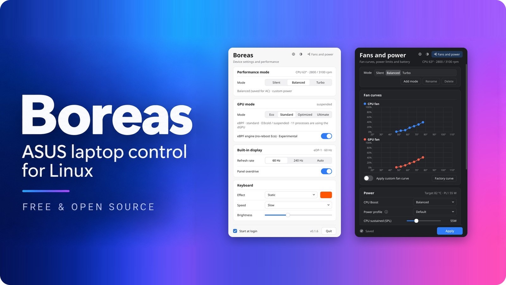
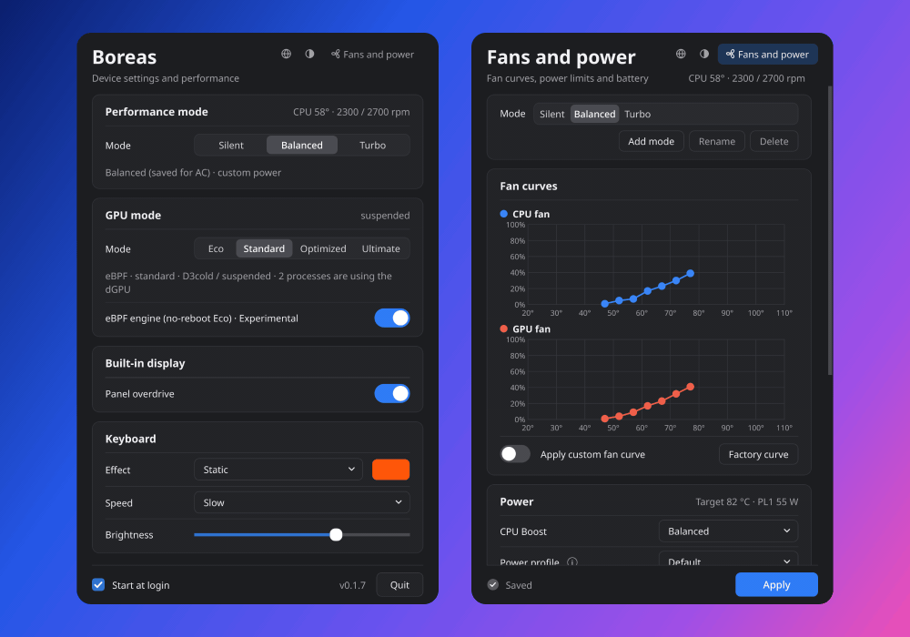

**One small window for your ASUS ROG or TUF laptop on Linux: every mode carries its own fans, power limits and temperature target.**

**English** · [Türkçe](README.tr.md)

<p align="center">
  
</p>

Boreas takes the place of Armoury Crate on Linux: one small
window for performance modes, custom fan curves, CPU and GPU power limits, GPU modes (Eco, Optimized and
the Ultimate MUX switch), Aura keyboard lighting and the battery charge limit. Every mode keeps its own
fans, power limits and CPU temperature target, so one click changes how the whole machine behaves. Free
and open source.

It builds on the work of the [asus-linux.org](https://asus-linux.org) community: most of the hardware support
comes from the kernel's asus-wmi driver, which asus-linux.org developers extended, and their asus-armoury
driver. Boreas replaces the userspace side (asusd,
supergfxd, rog-control-center) with a single small system service (`boreasd`) and a tray app (`boreas`);
for the CPU temperature ceiling on Ryzen it adds a small kernel module of its own.

Boreas is written from scratch for Linux in Python and Qt, with a small C kernel module and a Rust GPU
helper. The only third-party code is in the optional eBPF GPU engine, which uses Cardwire (GPL-3.0); where
Boreas learned hardware details from other projects is listed in the
[third-party notices](THIRD_PARTY_NOTICES.md). The interface will be familiar to
[G-Helper](https://github.com/seerge/g-helper) users on Windows; Boreas itself is an independent
implementation for Linux.

## Quick start

```bash
git clone https://github.com/Yusuf-Yonturk/boreas.git && cd boreas && sudo ./install.sh
```

Then open **Boreas** from the application menu, or run `boreas`. The requirements are under
[Install](#install), with [what the installer changes](#what-the-installer-changes-on-your-system);
`sudo ./uninstall.sh` removes Boreas and brings back the services it masked; its settings stay in
`/etc/boreas`.

## Why Boreas

- **One window, one service.** The whole userspace side is `boreasd` and a tray app, in place of asusd,
  supergfxd and rog-control-center. The main controls are also on the command line (`boreasctl`: mode, GPU
  mode, charge limit, keyboard brightness, temperature target and floor); fan curves, power limits, CPU
  Boost, power profile and keyboard effects are set in the window.
- **A mode is a complete preset.** Fan curves, power limits, CPU Boost, power profile and temperature
  target are stored per mode, and you can add your own modes next to Silent / Balanced / Turbo. Switching
  mode changes all of it at once: from the window, the tray, Fn+F5, or automatically on battery / AC.
- **A CPU temperature target.** Pick 75-95 °C for a mode. On supported AMD Ryzen laptops the CPU itself
  holds it; elsewhere Boreas steers the power limits towards it, with an optional power floor so a gaming
  mode does not fall to the firmware's minimum.
- **Eco without a reboot** on laptops with an NVIDIA dGPU, through the optional eBPF GPU backend (experimental).
- **11 languages, light and dark, in-app updates**, and a layout that is familiar if you come from Windows.
- **Easy to try, easy to undo.** On first start Boreas takes over your current charge limit, keyboard
  brightness, mode and GPU mode; fan curves, power limits and CPU Boost start from the firmware defaults.
  `sudo ./uninstall.sh` brings asusd, supergfxd and power-profiles-daemon back; Boreas's settings stay in
  `/etc/boreas`.

**Boreas or asusctl?** If you want one window where every mode carries its own fans, power limits and
temperature target, choose Boreas. If you need the AniMe Matrix or Slash display, choose
[asusctl](https://github.com/OpenGamingCollective/asusctl), the asus-linux.org project's own tool. They
write the same kernel files, so only one can run at a time; the installer masks asusd and supergfxd and the
uninstaller brings them back.

## Tested hardware

| Model | Distribution, kernel | Status |
|---|---|---|
| ROG Strix G713PV | CachyOS, kernel 7.3 (asus-armoury) | developed and tested here |

Boreas is built on the kernel's standard asus-wmi / asus-armoury interfaces, so it is not written for one
model. Cards for hardware it does not find (GPU modes, panel overdrive, refresh rate) stay hidden. Your
model can be the next row: run Boreas, then send a
[hardware report](https://github.com/Yusuf-Yonturk/boreas/issues/new?template=hardware_report.yml),
whether everything worked or not.

## Features

| Feature | Boreas | Linux interface |
|---|---|---|
| Silent / Balanced / Turbo | ✓ | `platform_profile` |
| Custom modes (Custom 1, 2…) | ✓ | based on a built-in mode (same `platform_profile`) |
| Per-mode fan curves | ✓ (CPU, GPU, mid) | `asus_custom_fan_curve` hwmon |
| CPU Boost mode (per mode) | ✓ (`Default` / `Disabled` / `Efficient` / `Balanced` / `Aggressive` / `Max`) | `cpufreq/boost`, `energy_performance_preference` |
| Power profile (per mode) | ✓ (`Default` / `Power saver` / `Performance`): the CPU frequency governor the desktop's power menu set before Boreas masked power-profiles-daemon | `cpufreq/scaling_governor` |
| Power limits (SPL/SPPT/FPPT) | ✓ | asus-armoury `ppt_*` |
| NVIDIA Dynamic Boost / temp target | ✓ | asus-armoury `nv_*` |
| CPU temperature target (75-95 °C, per mode) | With bounded ASUS CPU power controls, or the CPU's own ceiling (Ryzen) | Software feedback through asus-armoury; the CPU's own ceiling on supported Ryzen laptops (kernel module, on by default) |
| Auto mode on battery / AC | ✓ | `power_supply` |
| GPU: Eco / Standard / Optimized / Ultimate | ✓ (Eco and Optimized with an NVIDIA dGPU) | `dgpu_disable`, `gpu_mux_mode` |
| Display: lowest rate / max / Auto (Auto also switches panel overdrive with AC) | ✓ (KDE) | `kscreen-doctor` |
| Panel overdrive | ✓ | `panel_overdrive` |
| Keyboard Aura (static, breathe with two colors, cycle, strobe; rainbow except on single-zone keyboards; Star, Rain, Highlight, Laser, Ripple, Comet, Flash on per-key keyboards; zone colors on four-zone keyboards) | ✓ | hidraw, report 0x5D (output report) |
| Keyboard color that follows the CPU temperature, GPU mode or battery | ✓ | hidraw, written by the service |
| Keyboard brightness | ✓ | `asus::kbd_backlight` |
| Charge limit | ✓ | `charge_control_end_threshold` |
| Fn+F5 | ✓ | the service watches `platform_profile` and re-applies the mode's settings |
| Re-apply after sleep | ✓ | systemd-sleep hook |

Not yet: AniMe/Slash matrix, M4/ROG key binding (bind `boreasctl mode next` to a KDE shortcut),
GPU clock offsets, Ryzen undervolt (Curve Optimizer), peripherals (mouse, headset), fan hysteresis,
keyboard light sleep/shutdown settings (Aura power), separate keyboard brightness for AC/battery,
one-time 100 % charge, boot sound (`boot_sound`), USB-C charging mode, per-key colors.

## Install

Requirements: a systemd-based distribution, a kernel with the asus-wmi / asus-armoury drivers,
Python 3.11+, PySide6 with Qt SVG (for the UI), `kscreen-doctor` for refresh-rate control on KDE, and Qt's Wayland
plugin for a sharp UI on Wayland. Install Python and PySide6 with your distribution's package manager
(on Arch / CachyOS: `sudo pacman -S --needed python pyside6 qt6-svg qt6-wayland`). Your user must be in the
`wheel` group to use the UI and `boreasctl`: the service socket is open to root and that group only.
Distributions without a `wheel` group (Debian, Ubuntu) need it created first; the installer warns about both.

```bash
git clone https://github.com/Yusuf-Yonturk/boreas.git
cd boreas
sudo ./install.sh
```

The optional eBPF GPU helper (`boreas-gpu-engine`) is not in the repository: CI builds it from
the Rust source and attaches it to the GitHub Release of each version, and the installer downloads
it for the version being installed and checks its sha256 before writing anything. If the download
fails, Boreas is installed without a new helper (one already installed is kept) and only the eBPF backend
may be unavailable. Offline, or to
install your own build, point the installer at a file: `sudo BOREAS_GPU_ENGINE=/path/to/boreas-gpu-engine ./install.sh`.
See [docs/gpu-engine.md](docs/gpu-engine.md).

The installer asks for the interface language (Enter keeps the previous choice, English on a first install). To skip the question:
`sudo BOREAS_LANG=de ./install.sh`. Each user can change the language later with the globe button in
the window. Chinese and Japanese need `noto-fonts-cjk`; Hindi and Arabic need `noto-fonts`.

### Arch / CachyOS: install as a package

The repository carries PKGBUILDs (`packaging/aur/`), so pacman can own the files and remove them again.
`boreas-git` builds the latest code on `main`:

```bash
git clone https://github.com/Yusuf-Yonturk/boreas.git
cd boreas/packaging/aur/boreas-git
makepkg -si
sudo boreas-setup enable
```

The package only puts the files in place; `sudo boreas-setup enable` hands the laptop to Boreas (the
same service changes as the installer, listed below) and `sudo boreas-setup disable` gives it back.
After `disable`, Boreas stays off through updates until `sudo boreas-setup enable`.
`sudo pacman -R boreas-git` runs the disable step for you. The package has no in-app update and no eBPF
GPU helper. To update, run `git pull` in the repository and `makepkg -si` in the same folder again.

### What the installer changes on your system

- It masks `asusd`, `asus-shutdown`, `supergfxd` and `power-profiles-daemon` and enables `boreasd`.
  They write the same sysfs files; `disable` is not enough because asusd is started by a udev rule on
  every boot and power-profiles-daemon by the desktop over D-Bus.
- The desktop's own power-profile menu (KDE battery applet, GNOME quick settings) therefore shows
  nothing; Boreas owns the mode. To hand control back temporarily:
  `sudo systemctl stop boreasd && sudo systemctl unmask power-profiles-daemon && sudo systemctl start power-profiles-daemon`.
  To give it back to Boreas (both must not run together, and the mask does not return by itself):
  `sudo systemctl mask --now power-profiles-daemon && sudo systemctl start boreasd`.
- On first start the service adopts the current charge limit, keyboard brightness, panel overdrive, mode
  and GPU mode. Custom fan curves and power limits set by another tool are not adopted: the mode is
  applied with firmware fan curves and power limits and the default CPU Boost policy.
- `boreasd` runs as root and listens on a local socket (`/run/boreas.sock`, `wheel` group). The
  service makes no network connections. The tray app asks GitHub for the latest release (it can be
  turned off, see [Updating](#updating)), and the installer downloads the GPU helper from this
  repository's GitHub Release.
- `sudo ./uninstall.sh` removes the masks the installer added and brings those services back. A service
  you had masked or disabled yourself before installing Boreas stays that way. (For a first install made
  with Boreas 0.1.7 or older, a service you had masked yourself is taken for one of Boreas's and comes
  back.)

If you hand the power profile back to the desktop (above), turn off KDE's per-AC/battery power profiles
(KDE > Settings > Power Management) or Boreas's auto mode on battery / AC.

## Usage

```bash
boreas                 # UI (tray)
boreasctl status
boreasctl mode turbo   # silent | balanced | turbo | next | prev | <id> (custom modes; ids in `boreasctl status`)
boreasctl gpu eco      # eco | standard | optimized | ultimate
boreasctl charge 80
boreasctl cputemp 85   # active mode; default = firmware default
boreasctl cpufloor 45  # the target never lowers SPL below 45 W; min = firmware minimum
```

The UI follows the system light/dark theme; the button in the header switches between auto, light
and dark. `BOREAS_THEME=light boreas` (or `dark`) picks a theme while the header button is on Auto, `BOREAS_SCALE=1` changes the UI
size (default `0.78`), `BOREAS_LANG=ja boreas` forces a language. The **Fans and power** button in the top right opens fan curves, power limits
and battery settings in the same window; press it again to go back.

## Updating

Boreas checks GitHub 10 seconds after it starts and then once a day; each check only asks GitHub
for the latest published release. When a newer version is available, the window shows
**Update · Release notes · Hide**. **Update** asks for your administrator password (pkexec), then a
helper installed with Boreas downloads the source of that release from GitHub as root, installs it and
the app restarts. **Release notes** opens
[CHANGELOG.md](CHANGELOG.md). The helper installs only a release newer than the installed one. From 0.1.10 on,
releases are immutable on GitHub: once published, the source and the GPU helper attached to a version cannot be swapped.

To update by hand instead:

```bash
cd boreas
git pull
sudo ./install.sh
```

Then press **Quit** in the window and start `boreas` again. The check can be turned off from the tray
menu (**Check for updates**) or with `BOREAS_NO_UPDATE_CHECK=1`.

## CPU temperature target

Each mode can have a 75-95 °C target. Above it Boreas lowers the ASUS CPU power limits through
`asus-armoury` and raises them again when the CPU cools, never above what the mode and your own limits
set. If the limits reach their floor and the CPU is still hot, it steps down the mode's CPU policy (EPP,
then boost off; under the Performance power profile boost off first, then the power profile, then EPP) and
restores it in reverse. An optional per-mode **sustained power floor** keeps a gaming mode at, say, 45 W
instead of the firmware's minimum (30 W on the G713PV). The floor applies to the software target only.

```bash
boreasctl cputemp 85        # target for the active mode
boreasctl cputemp default   # turn it off
boreasctl cpufloor 45       # sustained power floor; `cpufloor min` = firmware minimum
```

**Without the CPU's own ceiling (below), Boreas holds this target in software, so the CPU can go above it
for a while.** Boost, firmware,
shared GPU cooling and service delays can cause such overshoots, and this software target is offered only
where the laptop exposes bounded ASUS CPU power controls; the CPU's own ceiling (below) does not need them.
Do not run another power tuning service at the same time. How the controller steps, what it does on
errors and the status fields are in [docs/cpu-temperature.md](docs/cpu-temperature.md).

**The CPU's own ceiling (Ryzen, on by default, still new).** On many AMD Ryzen laptops the target can instead be handed to
the CPU itself; the CPU then holds it within milliseconds. This needs a
small kernel module that is built with DKMS. The installer switches it on by default on every Ryzen family
listed below; `dkms` and your kernel's headers must be installed for the module to build. The command is AMD's
own (the SMU's temperature-limit message); RyzenAdj and G-Helper send the same one, so it is well tested. Switching it off is saved in `/etc/boreas/smu-off`, so later
installs and updates leave it off:

```bash
sudo BOREAS_SMU=0 ./install.sh # switch it off and keep it off across installs and updates
sudo BOREAS_SMU=1 ./install.sh # switch it on again
```

Installed as a package (see above)? Then the module is a package of its own, removed again with
`sudo pacman -R boreas-smu-dkms`:

```bash
cd boreas/packaging/aur/boreas-smu-dkms
makepkg -si
sudo modprobe boreas_smu && sudo systemctl try-restart boreasd   # or reboot
```

Boreas recognises the CPU family by itself (Ryzen 2000-5000 mobile and G-series APUs, 6000-8000 mobile,
the 7045HX and 9000HX series, Ryzen AI 300 / AI Max; not the desktop Ryzen 3000 / 5000 without graphics). The module refuses to load on any other CPU, and on a BIOS that does not offer the
lock it shares with the BIOS (`\_SB.AM00`). When the module is missing, refuses, or reports an error,
Boreas keeps the software target above. Details and the list of families are in
[docs/cpu-smu.md](docs/cpu-smu.md).

To see in 10 seconds, without installing anything, whether your laptop can use it (CPU family and the
BIOS lock):

```bash
curl -LO https://raw.githubusercontent.com/Yusuf-Yonturk/boreas/main/tools/smu-check.sh
sudo sh smu-check.sh
```

## GPU modes

- **Ultimate** <-> others switches the MUX and requires a reboot.
- **Eco --> Standard** works right away, without a reboot.
- **Standard --> Eco** can freeze the system if `dgpu_disable` is written while the dGPU driver is
  bound. The service first stops nvidia-persistenced and nvidia-powerd, unloads the NVIDIA modules
  and removes the PCI device. If the dGPU is in use (KWin, games, CUDA), Eco is postponed: the
  service retries every 15 s and applies it before the display manager on boot. On KDE Plasma
  (Wayland) KWin keeps the dGPU open for the whole session, so there Eco is applied on the next
  boot. If the NVIDIA module cannot be unloaded, or Eco fails for another reason, it stops retrying until you
  choose Eco again or reboot.
- **Eco and Optimized need an NVIDIA dGPU.** The steps above only know how to let go of an NVIDIA
  dGPU, so on a laptop with a Radeon dGPU (for example the 2022 ROG Zephyrus G14) Eco and Optimized
  are not shown and the service refuses them. Standard and Ultimate work as usual. A saved Eco or
  Optimized mode falls back to Standard with a notice.

## Experimental eBPF GPU engine

An opt-in backend adapted from Cardwire that blocks access to the dGPU instead of removing it, so Eco
does not need a reboot. Like Eco itself it needs an NVIDIA dGPU. The installer puts the helper in place (see [Install](#install)); it stays off
until you switch it on with **eBPF engine (no-reboot Eco) · Experimental** in the **GPU mode** card or:

```bash
boreasctl gpu-backend ebpf       # enable eBPF GPU blocking
boreasctl gpu-backend firmware   # return to the default ASUS firmware backend
```

Blocking access does not prove the GPU is asleep, and this is not a power-saving claim: on the G713PV
the GPU reached D3cold with one kernel and stayed awake with another. Building it, keeping a patched
helper across upgrades, the limits and the test record are in [docs/gpu-engine.md](docs/gpu-engine.md).

## Development

```bash
python3 -m unittest discover -s tests   # fake sysfs tree, no root needed
python3 -m boreas.gui.app               # UI (the service must be running)
```

Settings: `/etc/boreas/config.json`. Socket: `/run/boreas.sock` (`wheel` group).

To publish a new version, raise `__version__` in `boreas/__init__.py`, add a section to
[CHANGELOG.md](CHANGELOG.md) and merge to `main`. Then push the tag `v<version>` and right away create the
release as a draft under your account:
`gh release create v<version> --verify-tag --draft --title "Boreas <version>"`. If no release exists when the release job runs, CI creates the draft itself. CI fills in the
notes from CHANGELOG.md, attaches the GPU helper the installer downloads, and publishes the release. The job
fails if the tag does not match `__version__` or CHANGELOG.md has no section for it. Releases are immutable
once published. Installed copies
show the update note within a day.

## Contributing

Feel free to contribute! Bug reports, translations and pull requests are all welcome, especially if
you own an ASUS laptop other than the ROG Strix G713PV. See [CONTRIBUTING.md](CONTRIBUTING.md) for the
workflow, tests and how to add a language.

## Acknowledgements

- [Cardwire](https://github.com/OpenGamingCollective/cardwire), by luytan and contributors,
  for the GPL-3.0 GPU access-control code used in the experimental Rust engine.
  See [third-party notices](THIRD_PARTY_NOTICES.md).
- Serge and the [G-Helper](https://github.com/seerge/g-helper) community, for their open-source work on
  ASUS hardware.
- The [asus-linux.org](https://asus-linux.org) community, for their work on the Linux kernel drivers
  (asus-wmi, asus-armoury) and asusctl.
- [RyzenAdj](https://github.com/FlyGoat/RyzenAdj), [PawnIO.Modules](https://github.com/namazso/PawnIO.Modules)
  and [ryzen_smu](https://github.com/amkillam/ryzen_smu), for their research on the AMD SMU.
- The [Linux Hardware Project](https://github.com/linuxhw/ACPI), for its public ACPI tables.

## License

Copyright (C) 2026 Yusuf Yontürk. Licensed under [GPL-3.0](LICENSE), except the kernel module in `smu/`,
which is GPL-2.0-only. The vendored Cardwire crates keep their GPL-3.0 license (see
[third-party notices](THIRD_PARTY_NOTICES.md)).

ASUS, ROG, TUF and Armoury Crate are trademarks of ASUSTeK Computer Inc.; this project is not affiliated with ASUS.
