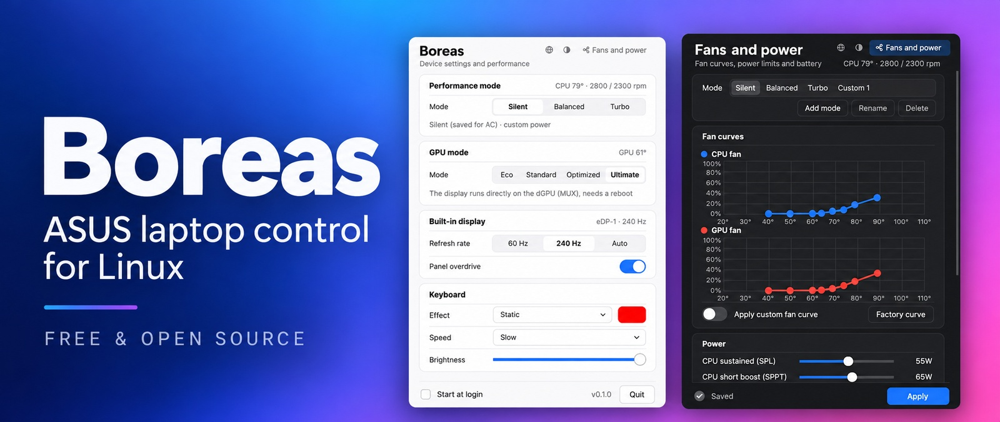
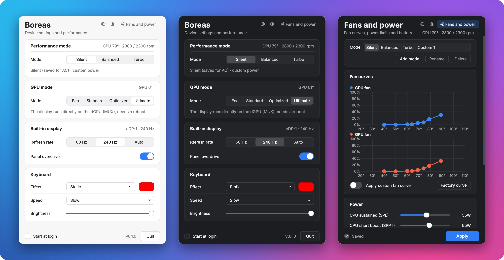

**Fan, CPU, GPU and battery control for ASUS ROG & TUF laptops on Linux.**

**English** · [Türkçe](README.tr.md)

Boreas is an open-source Armoury Crate alternative for Linux. It manages performance modes, custom fan
curves, CPU and GPU power limits, GPU modes (Eco, Optimized and the Ultimate MUX switch), Aura keyboard
lighting and the battery charge limit on ASUS ROG and TUF laptops.

It builds on the work of the [asus-linux.org](https://asus-linux.org) community: all the hardware support
comes from their kernel drivers (asus-wmi, asus-armoury). Boreas replaces the userspace side (asusd,
supergfxd, rog-control-center) with a single small system service (`boreasd`) and a tray app (`boreas`).



Developed and tested on a ROG Strix G713PV with CachyOS (kernel 7.3, asus-armoury); other models and
distributions may behave differently.

**Languages:** English, Türkçe, 简体中文, हिन्दी, Español, العربية, Français, Português (Brasil), Русский,
Deutsch, 日本語.

## Features

| Feature | Boreas | Linux interface |
|---|---|---|
| Silent / Balanced / Turbo | ✓ | `platform_profile` |
| Custom modes (Custom 1, 2…) | ✓ | bound to a built-in mode on the same base |
| Per-mode fan curves | ✓ (CPU, GPU, mid) | `asus_custom_fan_curve` hwmon |
| CPU Boost mode (per mode) | ✓ (`Default` / `Disabled` / `Efficient` / `Balanced` / `Aggressive` / `Max`) | `cpufreq/boost`, `energy_performance_preference` |
| Power limits (SPL/SPPT/FPPT) | ✓ | asus-armoury `ppt_*` |
| NVIDIA Dynamic Boost / temp target | ✓ | asus-armoury `nv_*` |
| CPU temperature target (75-95 °C, per mode) | With bounded ASUS CPU power controls | Software feedback through asus-armoury |
| Auto mode on battery / AC | ✓ | `power_supply` |
| GPU: Eco / Standard / Optimized / Ultimate | ✓ | `dgpu_disable`, `gpu_mux_mode` |
| Display 60 Hz / max / Auto | ✓ (KDE) | `kscreen-doctor` |
| Panel overdrive | ✓ | `panel_overdrive` |
| Keyboard Aura (static, breathe, cycle, rainbow, strobe) | ✓ | hidraw, report 0x5D (output report) |
| Keyboard brightness | ✓ | `asus::kbd_backlight` |
| Charge limit | ✓ | `charge_control_end_threshold` |
| Fn+F5 / KDE power profile | ✓ | the service watches profile changes and re-applies mode settings |
| Re-apply after sleep | ✓ | systemd-sleep hook |

Not yet: AniMe/Slash matrix, M4/ROG key binding (bind `boreasctl mode next` to a KDE shortcut),
GPU clock offsets, Ryzen undervolt (Curve Optimizer), peripherals (mouse, headset), fan hysteresis,
keyboard light sleep/shutdown settings (Aura power), separate keyboard brightness for AC/battery,
one-time 100 % charge, boot sound (`boot_sound`), USB-C charging mode, Aura second color.

## Install

Requirements: a systemd-based distribution, a kernel with the asus-wmi / asus-armoury drivers,
Python 3.11+, PySide6 (for the UI), `kscreen-doctor` for refresh-rate control on KDE, and Qt's Wayland
plugin for a sharp UI on Wayland. Install Python and PySide6 with your distribution's package manager
(on Arch / CachyOS: `sudo pacman -S --needed python pyside6 qt6-wayland`).

```bash
git clone https://github.com/Yusuf-Yonturk/boreas.git
cd boreas
sudo ./install.sh
```

The installer asks for the interface language (Enter = English). To skip the question:
`sudo BOREAS_LANG=de ./install.sh`. Each user can change the language later with the globe button in
the window. Chinese and Japanese need `noto-fonts-cjk`; Hindi and Arabic need `noto-fonts`.

The script masks `asusd`, `asus-shutdown` and `supergfxd` (they write the same sysfs files;
`disable` is not enough because asusd is started by a udev rule on every boot) and enables
`boreasd`. On first start the service adopts the current charge limit, keyboard brightness,
mode and GPU mode; it writes nothing to the hardware.

Uninstall: `sudo ./uninstall.sh` (removes the masks and brings asusd / supergfxd back).

If KDE → Settings → Power Management uses different power profiles for AC and battery, it conflicts
with Boreas's "auto mode on battery / AC"; turn one of them off.

## Usage

```bash
boreas                 # UI (tray)
boreasctl status
boreasctl mode turbo   # silent | balanced | turbo | next | prev
boreasctl gpu eco      # eco | standard | optimized | ultimate
boreasctl charge 80
boreasctl cputemp 85   # active mode; default = firmware default
```

The UI follows the system light/dark theme; the button in the header switches between auto, light
and dark. `BOREAS_THEME=light boreas` (or `dark`) forces a theme, `BOREAS_SCALE=1` changes the UI
size (default `0.78`), `BOREAS_LANG=ja boreas` forces a language. The **Fans and power** button in the top right opens fan curves, power limits
and battery settings in the same window; press it again to go back.

## Updating

Boreas checks GitHub 10 seconds after it starts and then once a day; each check only downloads the
small file that holds the version number. When a newer version is available, the window shows
**Update · Release notes · Hide**. **Update** downloads the latest version from GitHub, installs it
after asking for your administrator password (pkexec) and restarts the app. **Release notes** opens
[CHANGELOG.md](CHANGELOG.md).

To update by hand instead:

```bash
cd boreas
git pull
sudo ./install.sh
```

Then press **Quit** in the window and start `boreas` again. The check can be turned off from the tray
menu (**Check for updates**) or with `BOREAS_NO_UPDATE_CHECK=1`.

## CPU temperature target

Boreas now approaches the selected 75-95 °C target by adjusting ASUS CPU power
limits through `asus-armoury` sysfs. It does not instantiate the old raw SMU
backend or fall back to PCI access. No BIOS-version allowlist or custom kernel
module is needed for this path. Support requires a CPU sensor and valid current,
minimum and maximum values for the exposed CPU power controls, including SPL.
This is capability detection, not a promise of support for every ASUS laptop.

The controller lowers SPL and available SPPT/FPPT at most once per second near
the target. After five cool seconds it recovers 1 W, never exceeding the values
captured after applying the selected profile and optional user power limits.
On models requiring custom fans, the profile's factory curves are enabled unless
the user selected custom curves. Choosing Default stops feedback and restores
power values still owned by the controller. Mode changes and resume reconfigure it.
An external profile change discards the previous profile's saved power values.

A missing sensor, rejected write, readback mismatch or external power change
stops feedback and reports an error; there is no automatic retry or SMU fallback.
Already lowered caps remain until Default or an explicit mode reapply. Do not run
another power tuning service concurrently. Sysfs readback can be cached by the
driver: it confirms the requested setting, not actual physical enforcement.

`boreasctl cputemp 85` sets the active mode's target; `cputemp default` disables it.
`cpu_temp` status reports `control: power-feedback`, `target`, `state`, `error`,
`ceilings_w`, `requested_w`, and `hard_limit: false`. `applied` is null because no
hardware temperature limit was programmed. The existing saved targets are reused.
A previous SMU setting is not reset by this backend; the normal firmware policy
or reboot may be needed to clear an old setting.

**This is a software target, not a hard temperature ceiling.** Boost, firmware,
shared GPU cooling and service delays can cause overshoots. At minimum power the
state becomes `limited` if temperature is still above target. An experimental
opt-in kernel SMU bridge (`smu-bridge`) is restricted to the documented G713PV /
G713PV.336 configuration; it is not a general ASUS SMU backend.
See [controller details](docs/cpu-temperature.md).

## GPU modes

- **Ultimate** ↔ others switches the MUX and requires a reboot.
- **Eco → Standard** works right away, without a reboot.
- **Standard → Eco** can freeze the system if `dgpu_disable` is written while the dGPU driver is
  bound. The service first stops nvidia-persistenced and nvidia-powerd, unloads the NVIDIA modules
  and removes the PCI device. If the dGPU is in use (KWin, games, CUDA), Eco is postponed: the
  service retries every 15 s and applies it before the display manager on boot. On KDE Plasma
  (Wayland) KWin keeps the dGPU open for the whole session, so there Eco is applied on the next
  boot. If the NVIDIA module is never released, it stops retrying until the next reboot.

## Experimental embedded GPU engine

An opt-in eBPF backend adapted from Cardwire is included (`boreas-gpu-engine`).
`sudo ./install.sh` installs a locally built `gpu-engine/target/release/boreas-gpu-engine`
if present, or falls back to the bundled prebuilt x86_64 helper binary (remaining disabled
by default). You can toggle **eBPF engine (no-reboot Eco) · Experimental** inside the **GPU mode**
card in the UI, or from the CLI:

```bash
boreasctl gpu-backend ebpf       # enable eBPF GPU blocking
boreasctl gpu-backend firmware   # return to default ASUS firmware backend
```

Install a patched helper at `/etc/boreas/boreas-gpu-engine` to preserve it across
upgrades; Boreas prefers this path and checks protocol compatibility. The installer
also preserves checksum-detected edits to its managed helper; unknown legacy
copies are backed up without auto-activation. Remove an old systemd backend
environment override before using the switch. Returning to firmware selects
**Standard**, preserving Ultimate and pending MUX requests.

Eco policy alone does not prove the GPU is asleep. In the 2026-11-02 G713PV test on
Linux `7.3.0-5-cachyos`, access blocking/restoration passed, but the GPU remained
`D0 / active` after 60 seconds and RTD3 reported `Not supported`. This is not a
power-saving or general hardware compatibility claim.

See [build instructions, limitations and validation checklist](docs/gpu-engine.md).

## Development

```bash
python3 -m unittest discover -s tests   # fake sysfs tree, no root needed
python3 -m boreas.gui.app               # UI (the service must be running)
```

Settings: `/etc/boreas/config.json`. Socket: `/run/boreas.sock` (`wheel` group).

To publish a new version, raise `__version__` in `boreas/__init__.py`, add a section to
[CHANGELOG.md](CHANGELOG.md) and push to `main`; installed copies show the update note within a day.

## Contributing

Feel free to contribute! Bug reports, translations and pull requests are all welcome, especially if
you own an ASUS laptop other than the ROG Strix G713PV. See [CONTRIBUTING.md](CONTRIBUTING.md) for the
workflow, tests and how to add a language.

## Acknowledgements

- [Cardwire](https://github.com/OpenGamingCollective/cardwire), by luytan and contributors,
  for the GPL-3.0 GPU access-control code used in the experimental Rust engine.
  See [third-party notices](THIRD_PARTY_NOTICES.md).

- Serge and the [G-Helper](https://github.com/seerge/g-helper) community, for their open-source work on
  ASUS hardware.
- The [asus-linux.org](https://asus-linux.org) community, for the Linux kernel drivers (asus-wmi,
  asus-armoury) and asusctl.
- [RyzenAdj](https://github.com/FlyGoat/RyzenAdj) and [ZenStates-Core](https://github.com/irusanov/ZenStates-Core),
  for their research on the AMD SMU.

## License

Copyright (C) 2026 Yusuf Yontürk. Licensed under [GPL-3.0](LICENSE).

ASUS, ROG, TUF and Armoury Crate are trademarks of ASUSTeK Computer Inc.; this project is not affiliated with ASUS.
