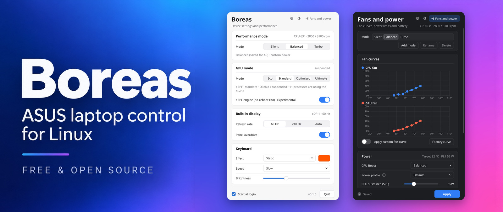
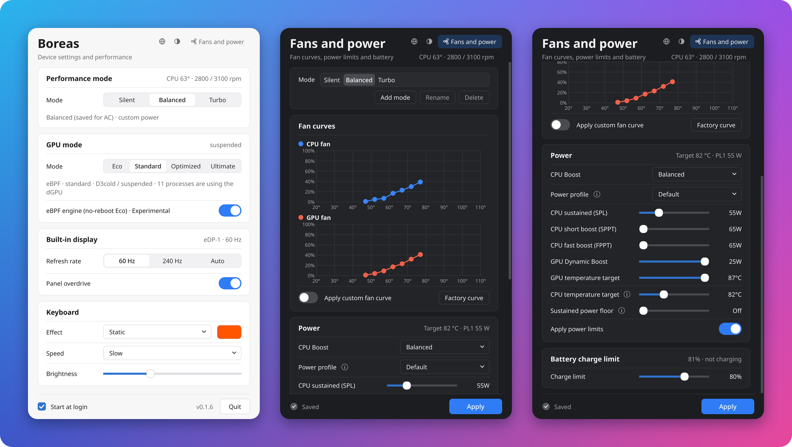

**The G-Helper-style control panel for ASUS ROG & TUF laptops on Linux.**

**English** · [Türkçe](README.tr.md)

Boreas gives your ASUS laptop on Linux what Armoury Crate and G-Helper give it on Windows: one small
window for performance modes, custom fan curves, CPU and GPU power limits, GPU modes (Eco, Optimized and
the Ultimate MUX switch), Aura keyboard lighting and the battery charge limit. Every mode keeps its own
fans, power limits and CPU temperature target, so one click changes how the whole machine behaves. Free
and open source.

It builds on the work of the [asus-linux.org](https://asus-linux.org) community: all the hardware support
comes from their kernel drivers (asus-wmi, asus-armoury). Boreas replaces the userspace side (asusd,
supergfxd, rog-control-center) with a single small system service (`boreasd`) and a tray app (`boreas`).

The window layout is modelled on [G-Helper](https://github.com/seerge/g-helper) on purpose, so it feels
familiar if you come from Windows. No code is shared: G-Helper is a Windows program, Boreas is written from
scratch in Python and Qt. Boreas is Linux only; on Windows, use G-Helper.



## Why Boreas

- **One window, one service.** The whole userspace side is `boreasd` and a tray app, in place of asusd,
  supergfxd and rog-control-center. Everything in the window is also on the command line (`boreasctl`).
- **A mode is a complete preset.** Fan curves, power limits, CPU Boost, power profile and temperature
  target are stored per mode, and you can add your own modes next to Silent / Balanced / Turbo. Switching
  mode changes all of it at once: from the window, the tray, Fn+F5, or automatically on battery / AC.
- **A CPU temperature target.** Pick 75-95 °C for a mode and Boreas steers the power limits towards it,
  with a power floor so a gaming mode does not fall to the firmware's minimum.
- **Eco without a reboot**, through the optional eBPF GPU backend (experimental).
- **The layout G-Helper users already know**, in 11 languages, light and dark, with in-app updates.
- **Easy to try, easy to undo.** On first start Boreas adopts your current settings and writes nothing to
  the hardware; `sudo ./uninstall.sh` brings asusd, supergfxd and power-profiles-daemon back.

**Boreas or asusctl?** If you want G-Helper on Linux, one window where every mode carries its own fans,
power limits and temperature target, choose Boreas. If you need the AniMe Matrix or Slash display, choose
[asusctl](https://github.com/OpenGamingCollective/asusctl), the asus-linux.org project's own tool. They
write the same kernel files, so only one can run at a time; the installer masks asusd and supergfxd and the
uninstaller brings them back.

## Tested hardware

| Model | Distribution, kernel | Status |
|---|---|---|
| ROG Strix G713PV | CachyOS, kernel 7.3 (asus-armoury) | developed and tested here |

Boreas is built on the kernel's standard asus-wmi / asus-armoury interfaces, so it is not written for one
model. Cards for hardware it does not find (GPU modes, panel overdrive, refresh rate) stay hidden. Your
model can be the next row: run Boreas, then [open an issue](https://github.com/Yusuf-Yonturk/boreas/issues/new/choose)
with the output of `boreasctl status` and `uname -r`, whether everything worked or not.

## Features

| Feature | Boreas | Linux interface |
|---|---|---|
| Silent / Balanced / Turbo | ✓ | `platform_profile` |
| Custom modes (Custom 1, 2…) | ✓ | bound to a built-in mode on the same base |
| Per-mode fan curves | ✓ (CPU, GPU, mid) | `asus_custom_fan_curve` hwmon |
| CPU Boost mode (per mode) | ✓ (`Default` / `Disabled` / `Efficient` / `Balanced` / `Aggressive` / `Max`) | `cpufreq/boost`, `energy_performance_preference` |
| Power profile (per mode) | ✓ (`Default` / `Power saver` / `Performance`): the CPU frequency governor the desktop's power menu set before Boreas masked power-profiles-daemon | `cpufreq/scaling_governor` |
| Power limits (SPL/SPPT/FPPT) | ✓ | asus-armoury `ppt_*` |
| NVIDIA Dynamic Boost / temp target | ✓ | asus-armoury `nv_*` |
| CPU temperature target (75-95 °C, per mode) | With bounded ASUS CPU power controls | Software feedback through asus-armoury |
| Auto mode on battery / AC | ✓ | `power_supply` |
| GPU: Eco / Standard / Optimized / Ultimate | ✓ | `dgpu_disable`, `gpu_mux_mode` |
| Display 60 Hz / max / Auto | ✓ (KDE) | `kscreen-doctor` |
| Panel overdrive | ✓ | `panel_overdrive` |
| Keyboard Aura (static, breathe, cycle, rainbow, strobe) | ✓ | hidraw, report 0x5D (output report) |
| Keyboard brightness | ✓ | `asus::kbd_backlight` |
| Charge limit | ✓ | `charge_control_end_threshold` |
| Fn+F5 / KDE power profile | ✓ | the service watches profile changes and re-applies mode settings |
| Re-apply after sleep | ✓ | systemd-sleep hook |

Not yet: AniMe/Slash matrix, M4/ROG key binding (bind `boreasctl mode next` to a KDE shortcut),
GPU clock offsets, Ryzen undervolt (Curve Optimizer), peripherals (mouse, headset), fan hysteresis,
keyboard light sleep/shutdown settings (Aura power), separate keyboard brightness for AC/battery,
one-time 100 % charge, boot sound (`boot_sound`), USB-C charging mode, Aura second color.

## Install

Requirements: a systemd-based distribution, a kernel with the asus-wmi / asus-armoury drivers,
Python 3.11+, PySide6 (for the UI), `kscreen-doctor` for refresh-rate control on KDE, and Qt's Wayland
plugin for a sharp UI on Wayland. Install Python and PySide6 with your distribution's package manager
(on Arch / CachyOS: `sudo pacman -S --needed python pyside6 qt6-wayland`).

```bash
git clone https://github.com/Yusuf-Yonturk/boreas.git
cd boreas
sudo ./install.sh
```

The optional eBPF GPU helper (`boreas-gpu-engine`) is not in the repository: CI builds it from
the Rust source and attaches it to the GitHub Release of each version, and the installer downloads
it for the version being installed and checks its sha256 before writing anything. Offline, or to
install your own build, point the installer at a file: `sudo BOREAS_GPU_ENGINE=/path/to/boreas-gpu-engine ./install.sh`.
See [docs/gpu-engine.md](docs/gpu-engine.md).

The installer asks for the interface language (Enter = English). To skip the question:
`sudo BOREAS_LANG=de ./install.sh`. Each user can change the language later with the globe button in
the window. Chinese and Japanese need `noto-fonts-cjk`; Hindi and Arabic need `noto-fonts`.

### What the installer changes on your system

- It masks `asusd`, `asus-shutdown`, `supergfxd` and `power-profiles-daemon` and enables `boreasd`.
  They write the same sysfs files; `disable` is not enough because asusd is started by a udev rule on
  every boot and power-profiles-daemon by the desktop over D-Bus.
- The desktop's own power-profile menu (KDE battery applet, GNOME quick settings) therefore shows
  nothing; Boreas owns the mode. To hand control back temporarily:
  `sudo systemctl stop boreasd && sudo systemctl unmask --now power-profiles-daemon`.
- On first start the service adopts the current charge limit, keyboard brightness, mode and GPU mode;
  it writes nothing to the hardware.
- `boreasd` runs as root and listens on a local socket (`/run/boreas.sock`, `wheel` group). The
  service makes no network connections. The tray app asks GitHub for the latest release (it can be
  turned off, see [Updating](#updating)), and the installer downloads the GPU helper from this
  repository's GitHub Release.
- `sudo ./uninstall.sh` removes the masks and brings asusd / supergfxd / power-profiles-daemon back.

If KDE → Settings → Power Management uses different power profiles for AC and battery, it conflicts
with Boreas's "auto mode on battery / AC"; turn one of them off.

## Usage

```bash
boreas                 # UI (tray)
boreasctl status
boreasctl mode turbo   # silent | balanced | turbo | next | prev
boreasctl gpu eco      # eco | standard | optimized | ultimate
boreasctl charge 80
boreasctl cputemp 85   # active mode; default = firmware default
boreasctl cpufloor 45  # the target never lowers SPL below 45 W; min = firmware minimum
```

The UI follows the system light/dark theme; the button in the header switches between auto, light
and dark. `BOREAS_THEME=light boreas` (or `dark`) forces a theme, `BOREAS_SCALE=1` changes the UI
size (default `0.78`), `BOREAS_LANG=ja boreas` forces a language. The **Fans and power** button in the top right opens fan curves, power limits
and battery settings in the same window; press it again to go back.

## Updating

Boreas checks GitHub 10 seconds after it starts and then once a day; each check only asks GitHub
for the latest published release. When a newer version is available, the window shows
**Update · Release notes · Hide**. **Update** downloads the source of that release from GitHub, installs it
after asking for your administrator password (pkexec) and restarts the app. **Release notes** opens
[CHANGELOG.md](CHANGELOG.md).

To update by hand instead:

```bash
cd boreas
git pull
sudo ./install.sh
```

Then press **Quit** in the window and start `boreas` again. The check can be turned off from the tray
menu (**Check for updates**) or with `BOREAS_NO_UPDATE_CHECK=1`.

## CPU temperature target

Each mode can have a 75-95 °C target. Above the target Boreas lowers the ASUS CPU power limits (SPL and,
where exposed, SPPT/FPPT) through `asus-armoury`; when the CPU cools it raises them again, never above
what the mode and your own power limits set. If the limits reach their floor and the CPU is still hot, it
steps below the mode's own CPU policy rung by rung (EPP notch by notch, then cpufreq boost off; with the
Performance power profile: boost off, then the default governor, then EPP) and restores them in reverse order. The per-mode **sustained power floor** keeps SPL
from being lowered below a chosen wattage, so a gaming mode can hold 45 W instead of the firmware's 30 W
minimum.

```bash
boreasctl cputemp 85        # target for the active mode
boreasctl cputemp default   # turn it off
boreasctl cpufloor 45       # sustained power floor; `cpufloor min` = firmware minimum
```

**This is a software target, not a hard temperature ceiling.** Boost, firmware, shared GPU cooling and
service delays can cause overshoots. At minimum power the state becomes `limited` if the temperature is
still above the target. It needs a CPU sensor and valid ranges for the exposed CPU power controls,
including SPL; this is capability detection, not a promise of support for every ASUS laptop. The default path needs no BIOS
allowlist and no custom kernel module, and nothing reaches the SMU through raw PCI access. Do not run another power tuning service
at the same time.

How the controller steps, what it does on errors, the status fields and the experimental `smu-bridge`
(G713PV / G713PV.336 only) are in [docs/cpu-temperature.md](docs/cpu-temperature.md).

## GPU modes

- **Ultimate** ↔ others switches the MUX and requires a reboot.
- **Eco → Standard** works right away, without a reboot.
- **Standard → Eco** can freeze the system if `dgpu_disable` is written while the dGPU driver is
  bound. The service first stops nvidia-persistenced and nvidia-powerd, unloads the NVIDIA modules
  and removes the PCI device. If the dGPU is in use (KWin, games, CUDA), Eco is postponed: the
  service retries every 15 s and applies it before the display manager on boot. On KDE Plasma
  (Wayland) KWin keeps the dGPU open for the whole session, so there Eco is applied on the next
  boot. If the NVIDIA module is never released, it stops retrying until the next reboot.

## Experimental embedded GPU engine

An opt-in eBPF backend adapted from Cardwire is included (`boreas-gpu-engine`).
`sudo ./install.sh` installs the x86_64 helper that CI built for this version from the GitHub
Release, after checking its sha256, or the file named by `BOREAS_GPU_ENGINE` (it remains disabled
by default). You can toggle **eBPF engine (no-reboot Eco) · Experimental** inside the **GPU mode**
card in the UI, or from the CLI:

```bash
boreasctl gpu-backend ebpf       # enable eBPF GPU blocking
boreasctl gpu-backend firmware   # return to default ASUS firmware backend
```

Install a patched helper at `/etc/boreas/boreas-gpu-engine` to preserve it across
upgrades; Boreas prefers this path and checks protocol compatibility. The installer
also preserves checksum-detected edits to its managed helper; unknown legacy
copies are backed up without auto-activation. Remove an old systemd backend
environment override before using the switch. Returning to firmware selects
**Standard**, preserving Ultimate and pending MUX requests.

Eco policy alone does not prove the GPU is asleep. In the 2026-11-02 G713PV test on
Linux `7.3.0-5-cachyos`, access blocking/restoration passed, but the GPU remained
`D0 / active` after 60 seconds and RTD3 reported `Not supported`. This is not a
power-saving or general hardware compatibility claim.

See [build instructions, limitations and validation checklist](docs/gpu-engine.md).

## Development

```bash
python3 -m unittest discover -s tests   # fake sysfs tree, no root needed
python3 -m boreas.gui.app               # UI (the service must be running)
```

Settings: `/etc/boreas/config.json`. Socket: `/run/boreas.sock` (`wheel` group).

To publish a new version, raise `__version__` in `boreas/__init__.py`, add a section to
[CHANGELOG.md](CHANGELOG.md), push to `main` and push the tag `v<version>`; CI then attaches the GPU
helper to that version's GitHub Release, which the installer downloads. Installed copies show the
update note within a day.

## Contributing

Feel free to contribute! Bug reports, translations and pull requests are all welcome, especially if
you own an ASUS laptop other than the ROG Strix G713PV. See [CONTRIBUTING.md](CONTRIBUTING.md) for the
workflow, tests and how to add a language.

## Acknowledgements

- [Cardwire](https://github.com/OpenGamingCollective/cardwire), by luytan and contributors,
  for the GPL-3.0 GPU access-control code used in the experimental Rust engine.
  See [third-party notices](THIRD_PARTY_NOTICES.md).

- Serge and the [G-Helper](https://github.com/seerge/g-helper) community, for their open-source work on
  ASUS hardware.
- The [asus-linux.org](https://asus-linux.org) community, for the Linux kernel drivers (asus-wmi,
  asus-armoury) and asusctl.
- [RyzenAdj](https://github.com/FlyGoat/RyzenAdj) and [ZenStates-Core](https://github.com/irusanov/ZenStates-Core),
  for their research on the AMD SMU.

## License

Copyright (C) 2026 Yusuf Yontürk. Licensed under [GPL-3.0](LICENSE).

ASUS, ROG, TUF and Armoury Crate are trademarks of ASUSTeK Computer Inc.; this project is not affiliated with ASUS.
