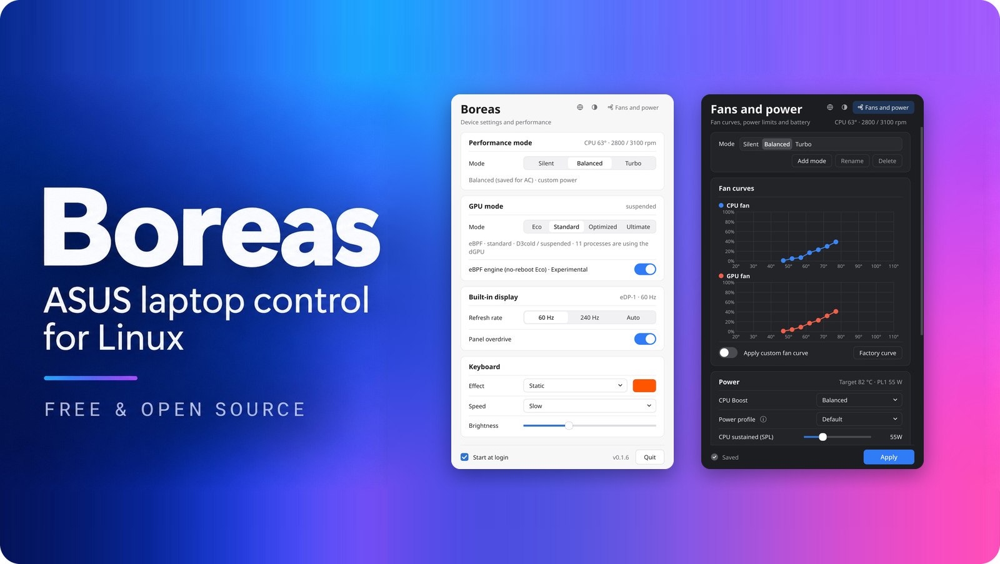
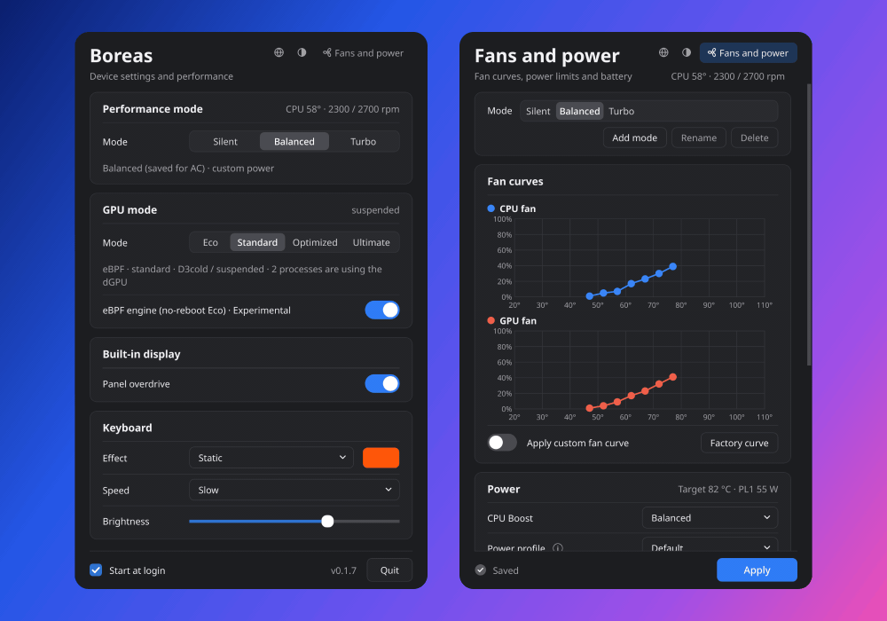

**Linux'ta ASUS ROG ve TUF dizüstüler için G-Helper tarzı kontrol paneli.**

[English](README.md) · **Türkçe**

<p align="center">
  
</p>

Boreas, Armoury Crate ve G-Helper'ın Windows'ta verdiğini ASUS dizüstünüze Linux'ta verir: performans
modları, özel fan eğrileri, CPU ve GPU güç limitleri, GPU modları (Eco, Optimized ve Ultimate MUX anahtarı),
Aura klavye aydınlatması ve pil şarj limiti için tek küçük pencere. Her mod kendi fanlarını, güç
limitlerini ve CPU sıcaklık hedefini taşır; tek tıkla bütün makinenin davranışı değişir. Özgür ve açık
kaynak.

[asus-linux.org](https://asus-linux.org) topluluğunun çalışması üzerine kuruludur: donanım desteğinin
tamamı onların çekirdek sürücülerinden (asus-wmi, asus-armoury) gelir. Boreas, kullanıcı tarafındaki kısmı
(asusd, supergfxd, rog-control-center) tek bir küçük sistem servisi (`boreasd`) ve bir tepsi uygulamasıyla
(`boreas`) değiştirir.

Pencere düzeni bilerek [G-Helper](https://github.com/seerge/g-helper) örnek alınarak yapıldı; Windows'tan
gelenlere tanıdık gelsin diye. Ortak kod yoktur: G-Helper bir Windows programıdır, Boreas Python ve Qt ile
sıfırdan yazıldı. Birkaç donanım ayrıntısı G-Helper ve asusctl okunarak öğrenildi; bunlar
[üçüncü taraf bildirimlerinde](THIRD_PARTY_NOTICES.md) yazılıdır. Boreas yalnız Linux içindir; Windows'ta
G-Helper kullanın.

## Hızlı başlangıç

```bash
git clone https://github.com/Yusuf-Yonturk/boreas.git && cd boreas && sudo ./install.sh
```

Sonra uygulama menüsünden **Boreas**'ı açın ya da `boreas` çalıştırın. Gereksinimler
[Kurulum](#kurulum) bölümünde, [kurulumun neyi değiştirdiği](#kurulum-sisteminizde-neyi-değiştirir) ile
birlikte yazılıdır; `sudo ./uninstall.sh` her şeyi geri alır.

## Neden Boreas

- **Tek pencere, tek servis.** Kullanıcı tarafının tamamı `boreasd` ve bir tepsi uygulamasıdır; asusd,
  supergfxd ve rog-control-center'ın yerini alır. Penceredeki her şey komut satırında da vardır (`boreasctl`).
- **Mod eksiksiz bir ön ayardır.** Fan eğrileri, güç limitleri, CPU Boost, güç profili ve sıcaklık hedefi
  mod başına saklanır; Sessiz / Dengeli / Turbo'nun yanına kendi modlarınızı ekleyebilirsiniz. Mod
  değişince hepsi birlikte değişir: pencereden, tepsiden, Fn+F5 ile ya da pil / prize göre otomatik.
- **CPU sıcaklık hedefi.** Bir mod için 75-95 °C seçin; Boreas güç limitlerini o hedefe göre yönetir. Güç
  tabanı sayesinde oyun modu firmware'in minimumuna düşmez.
- **Yeniden başlatmadan Eco**, isteğe bağlı eBPF GPU arka ucuyla (deneysel).
- **G-Helper kullananların zaten bildiği düzen**, 11 dilde, açık ve koyu temayla, uygulama içi güncellemeyle.
- **Denemesi kolay, geri alması kolay.** İlk açılışta Boreas mevcut ayarlarınızı benimser ve donanıma
  hiçbir şey yazmaz; `sudo ./uninstall.sh` asusd, supergfxd ve power-profiles-daemon'ı geri getirir.

**Boreas mı, asusctl mi?** Linux'ta G-Helper istiyorsanız, yani her modun kendi fanlarını, güç limitlerini
ve sıcaklık hedefini taşıdığı tek bir pencere, Boreas'ı seçin. AniMe Matrix ya da Slash ekranı gerekiyorsa
asus-linux.org projesinin kendi aracı olan [asusctl](https://github.com/OpenGamingCollective/asusctl)'i
seçin. İkisi aynı çekirdek dosyalarına yazar, aynı anda yalnız biri çalışabilir; kurulum asusd ve
supergfxd'yi maskeler, kaldırma betiği geri getirir.

## Denenen donanım

| Model | Dağıtım, çekirdek | Durum |
|---|---|---|
| ROG Strix G713PV | CachyOS, kernel 7.3 (asus-armoury) | burada geliştirildi ve denendi |

Boreas çekirdeğin standart asus-wmi / asus-armoury arayüzleri üzerine kuruludur, tek bir model için
yazılmadı. Bulamadığı donanımın kartları (GPU modları, panel overdrive, yenileme hızı) gizli kalır.
Sıradaki satır sizin modeliniz olabilir: Boreas'ı çalıştırın, sonra her şey çalışsa da çalışmasa da bir
[donanım raporu](https://github.com/Yusuf-Yonturk/boreas/issues/new?template=hardware_report.yml) gönderin.

## Özellikler

| Özellik | Boreas | Linux arayüzü |
|---|---|---|
| Sessiz / Dengeli / Turbo | ✓ | `platform_profile` |
| Özel modlar (Özel 1, 2…) | ✓ | aynı tabanda yerleşik moda bağlı |
| Mod başına fan eğrisi | ✓ (CPU, GPU, orta) | `asus_custom_fan_curve` hwmon |
| CPU Boost modu (mod başına) | ✓ (`Varsayılan` / `Kapalı` / `Verimli` / `Dengeli` / `Agresif` / `Maks`) | `cpufreq/boost`, `energy_performance_preference` |
| Güç profili (mod başına) | ✓ (`Varsayılan` / `Güç tasarrufu` / `Performans`): Boreas power-profiles-daemon'ı maskelemeden önce masaüstünün güç menüsünün ayarladığı CPU frekans governor'ı | `cpufreq/scaling_governor` |
| Güç limitleri (SPL/SPPT/FPPT) | ✓ | asus-armoury `ppt_*` |
| NVIDIA Dynamic Boost / sıcaklık hedefi | ✓ | asus-armoury `nv_*` |
| CPU sıcaklık hedefi (75-95 °C, mod başına) | Aralığı bildirilen ASUS CPU güç kontrolleriyle | asus-armoury üzerinden yazılımsal kontrol |
| Pil/prize göre otomatik mod | ✓ | `power_supply` |
| GPU: Eco / Standart / Optimized / Ultimate | ✓ | `dgpu_disable`, `gpu_mux_mode` |
| Ekran 60 Hz / maks / Otomatik | ✓ (KDE) | `kscreen-doctor` |
| Panel overdrive | ✓ | `panel_overdrive` |
| Klavye Aura (statik, iki renkli nefes, döngü, gökkuşağı, strobe; tuş başına RGB klavyelerde Star, Rain, Highlight, Laser, Ripple, Comet, Flash; 4 bölgeli klavyelerde bölge renkleri) | ✓ | hidraw, rapor 0x5D (output rapor) |
| CPU sıcaklığını, GPU modunu ya da pili izleyen klavye rengi | ✓ | hidraw, rengi servis yazar |
| Klavye parlaklığı | ✓ | `asus::kbd_backlight` |
| Şarj limiti | ✓ | `charge_control_end_threshold` |
| Fn+F5 / KDE güç profili | ✓ | servis profil değişimini izler, mod ayarlarını yeniden uygular |
| Uykudan dönüşte yeniden uygulama | ✓ | systemd-sleep kancası |

Henüz yok: AniMe/Slash matrix, M4/ROG tuşu ataması (KDE kısayoluna `boreasctl mode next`
bağlanabilir), GPU saat ofsetleri, Ryzen undervolt (Curve Optimizer), çevre birimleri (fare, kulaklık),
fan histerezisi, klavye ışığının uyku/kapanış ayarları (Aura power), prize/pile göre ayrı
klavye parlaklığı, tek seferlik %100 şarj, açılış sesi (`boot_sound`), USB-C şarj modu,
tuş başına renk.

## Kurulum

Gereksinimler: systemd kullanan bir dağıtım, asus-wmi / asus-armoury sürücüleri olan bir çekirdek,
Python 3.11+, PySide6 (arayüz için), KDE'de ekran yenileme hızı için `kscreen-doctor` ve Wayland'de keskin
görüntü için Qt'nin Wayland eklentisi. Python ve PySide6'yı dağıtımınızın paket yöneticisiyle kurun
(Arch / CachyOS'ta: `sudo pacman -S --needed python pyside6 qt6-wayland`). Arayüzü ve `boreasctl`'i
kullanmak için kullanıcınız `wheel` grubunda olmalı: servis soketi yalnız root'a ve bu gruba açıktır.
`wheel` grubu olmayan dağıtımlarda (Debian, Ubuntu) önce grubun oluşturulması gerekir; kurulum betiği iki
durumda da uyarır.

```bash
git clone https://github.com/Yusuf-Yonturk/boreas.git
cd boreas
sudo ./install.sh
```

İsteğe bağlı eBPF GPU yardımcısı (`boreas-gpu-engine`) depoda tutulmaz: CI onu Rust kaynağından
derleyip her sürümün GitHub Release'ine ekler; kurulum betiği kurulan sürüm için indirir ve hiçbir
şey yazmadan önce sha256 sağlama toplamını denetler. İndirme başarısız olursa Boreas yardımcısız
kurulur ve yalnız eBPF arka ucu kullanılamaz. Çevrimdışı kurmak ya da kendi derlemenizi kurmak
için dosyayı gösterin: `sudo BOREAS_GPU_ENGINE=/yol/boreas-gpu-engine ./install.sh`.
Bkz. [docs/gpu-engine.md](docs/gpu-engine.md).

Kurulum arayüz dilini sorar (Enter = English). Sormadan kurmak için: `sudo BOREAS_LANG=tr ./install.sh`.
Her kullanıcı dili sonradan penceredeki küre düğmesinden değiştirebilir. Çince ve Japonca için
`noto-fonts-cjk`, Hintçe ve Arapça için `noto-fonts` gerekir.

### Kurulum sisteminizde neyi değiştirir

- `asusd`, `asus-shutdown`, `supergfxd` ve `power-profiles-daemon`'ı maskeler, `boreasd`'yi açar.
  Hepsi aynı sysfs dosyalarına yazıyor; asusd udev kuralıyla, power-profiles-daemon masaüstü tarafından
  D-Bus ile her açılışta başlatıldığı için `disable` yetmez.
- Masaüstünün kendi güç profili menüsü (KDE pil simgesi, GNOME hızlı ayarlar) bu yüzden boş görünür;
  modu Boreas yönetir. Kontrolü geçici olarak geri vermek için:
  `sudo systemctl stop boreasd && sudo systemctl unmask power-profiles-daemon && sudo systemctl start power-profiles-daemon`.
  Kontrolü Boreas'a geri vermek için (ikisi birlikte çalışmamalı, maske kendiliğinden geri gelmez):
  `sudo systemctl mask --now power-profiles-daemon && sudo systemctl start boreasd`.
- İlk açılışta servis mevcut şarj limitini, klavye parlaklığını, modu ve GPU modunu benimser;
  donanıma hiçbir şey yazmaz.
- `boreasd` root olarak çalışır ve yerel bir soketi dinler (`/run/boreas.sock`, `wheel` grubu). Servis
  ağa bağlanmaz. Tepsi uygulaması GitHub'a son sürümü sorar (kapatılabilir, bkz.
  [Güncelleme](#güncelleme)), kurulum betiği de GPU yardımcısını bu deponun GitHub Release'inden indirir.
- `sudo ./uninstall.sh` kurulumun eklediği maskeleri kaldırır ve o servisleri geri açar. Boreas'ı kurmadan
  önce kendi maskelediğiniz ya da kapattığınız bir servis olduğu gibi kalır.

KDE'de Ayarlar → Güç Yönetimi'nde prize ve pile ayrı güç profili seçiliyse Boreas'ın
"pil/prize göre otomatik mod"uyla çakışır; ikisinden birini kapatın.

## Kullanım

```bash
boreas                 # arayüz (tepsi)
boreasctl status
boreasctl mode turbo   # sessiz | dengeli | turbo | next | prev
boreasctl gpu eco      # eco | standard | optimized | ultimate
boreasctl charge 80
boreasctl cputemp 85   # etkin mod; default = firmware varsayılanı
boreasctl cpufloor 45  # hedef SPL'yi 45 W altına çekmez; min = firmware minimumu
```

Arayüz sistemin açık/koyu temasını izler; başlıktaki düğme otomatik, açık ve koyu arasında geçer.
Zorlamak için `BOREAS_THEME=light boreas` ya da `dark`. `BOREAS_SCALE=1` arayüz boyutunu değiştirir
(varsayılan `0.78`), `BOREAS_LANG=tr boreas` dili zorlar. Sağ üstteki **Fanlar ve güç** düğmesi aynı pencerede fan eğrileri,
güç limitleri ve pil sayfasını açar; tekrar basınca ana sayfaya döner.

## CPU sıcaklık hedefi

Her moda 75-95 °C arasında bir hedef verilebilir. Hedefin üstünde Boreas, ASUS'un CPU güç limitlerini
`asus-armoury` üzerinden düşürür, CPU soğuyunca yeniden yükseltir; modun ve sizin limitlerinizin
belirlediği değerin üstüne hiç çıkmaz. Limitler tabana inip CPU hâlâ sıcaksa modun CPU politikasını
kademe kademe düşürür (EPP, sonra boost kapalı), soğuyunca ters sırayla geri alır. Mod başına **sürekli
güç tabanı** sayesinde bir oyun modu firmware'in 30 W minimumu yerine örneğin 45 W'ta tutulabilir.

```bash
boreasctl cputemp 85        # etkin modun hedefi
boreasctl cputemp default   # kapat
boreasctl cpufloor 45       # sürekli güç tabanı; `cpufloor min` = firmware minimumu
```

**Bu yazılımsal bir hedeftir, kesin sıcaklık tavanı değildir.** Boost, firmware, GPU ile paylaşılan
soğutma ve servis gecikmeleri hedefin aşılmasına yol açabilir; özellik yalnız dizüstünün CPU güç
kontrollerini sunduğu yerde görünür. Başka bir güç ayarlama servisiyle birlikte çalıştırmayın.
Denetleyicinin adımları, hata durumunda ne yaptığı ve durum alanları
[docs/cpu-temperature.md](docs/cpu-temperature.md) dosyasında.

## Güncelleme

Boreas açıldıktan 10 saniye sonra, ardından günde bir kez GitHub'a bakar; her seferinde yalnızca yayımlanmış
son sürümü sorar. Yeni bir sürüm varsa pencerede **Güncelle · Sürüm notları ·
Gizle** görünür. **Güncelle** o sürümün kaynağını GitHub'dan indirir, yönetici şifrenizi sorduktan sonra (pkexec)
kurar ve uygulamayı yeniden başlatır. **Sürüm notları** [CHANGELOG.md](CHANGELOG.md) dosyasını açar.

Elle güncellemek için:

```bash
cd boreas
git pull
sudo ./install.sh
```

Ardından pencerede **Çıkış**'a basıp `boreas` ile yeniden açın. Kontrol tepsi menüsünden
(**Güncellemeleri denetle**) ya da `BOREAS_NO_UPDATE_CHECK=1` ile kapatılabilir.

## GPU modları hakkında

- **Ultimate** ↔ diğerleri MUX'u değiştirir, yeniden başlatma gerekir.
- **Eco → Standard** yeniden başlatmadan hemen geçer.
- **Standard → Eco**: dGPU sürücüsü bağlıyken `dgpu_disable` yazılırsa sistem kilitlenebilir. Servis
  önce nvidia-persistenced ve nvidia-powerd'yi durdurur, NVIDIA modüllerini kaldırır ve PCI aygıtını
  çıkarır. dGPU kullanımdaysa (KWin, oyun, CUDA) Eco ertelenir: servis 15 saniyede bir yeniden dener ve
  açılışta ekran yöneticisinden önce uygular. KDE Plasma'da (Wayland) KWin dGPU'yu oturum boyunca açık
  tuttuğu için Eco orada bir sonraki açılışta uygulanır. NVIDIA modülü hiç bırakılmıyorsa yeniden
  başlatmaya kadar tekrar denemez.

## Deneysel eBPF GPU motoru

Cardwire kodundan uyarlanmış isteğe bağlı bir arka uç: harici GPU'yu kaldırmak yerine ona erişimi
engeller, böylece Eco yeniden başlatma istemez. Yardımcı programı kurulum betiği yerleştirir
([Kurulum](#kurulum) bölümüne bakın); **GPU modu** kartındaki **eBPF motoru (yeniden başlatmadan Eco) ·
Deneysel** anahtarıyla ya da şu komutla açana kadar kapalı kalır:

```bash
boreasctl gpu-backend ebpf       # eBPF GPU motorunu etkinleştir
boreasctl gpu-backend firmware   # varsayılan ASUS firmware yöntemine dön
```

Erişimi engellemek GPU'nun uyuduğunu göstermez ve bu bir güç tasarrufu iddiası değildir: G713PV'de GPU
bir çekirdekle D3cold'a indi, bir başkasıyla uyanık kaldı. Derleme, yamalı yardımcıyı güncellemelerde
koruma, sınırlar ve test kaydı [docs/gpu-engine.md](docs/gpu-engine.md) dosyasında.

## Geliştirme

```bash
python3 -m unittest discover -s tests   # sahte sysfs ağacıyla, root gerekmez
python3 -m boreas.gui.app               # arayüz (servis çalışıyor olmalı)
```

Ayarlar: `/etc/boreas/config.json`. Soket: `/run/boreas.sock` (`wheel` grubu).

Yeni sürüm yayınlamak için `boreas/__init__.py` içindeki `__version__` değerini artırın, [CHANGELOG.md](CHANGELOG.md)
dosyasına bir bölüm ekleyin, `main`'e gönderin ve `v<sürüm>` etiketini gönderin; CI GPU yardımcısını o sürümün
GitHub Release'ine ekler, kurulum betiği oradan indirir. Kurulu kopyalar bir gün içinde güncelleme notunu gösterir.

## Katkıda bulunma

Katkıda bulunmaktan çekinmeyin! Hata bildirimleri, çeviriler ve pull request'ler memnuniyetle
karşılanır; özellikle ROG Strix G713PV dışında bir ASUS laptopunuz varsa. Çalışma adımları, testler ve
yeni dil ekleme için [CONTRIBUTING.tr.md](CONTRIBUTING.tr.md) dosyasına bakın.

## Teşekkürler

- Deneysel Rust motorunda kullanılan GPL-3.0 GPU erişim kontrolü kodu için
  luytan, katkıcıları ve [Cardwire](https://github.com/OpenGamingCollective/cardwire) projesine.
  [Üçüncü taraf bildirimleri](THIRD_PARTY_NOTICES.md).
- ASUS donanımı üzerine yaptıkları açık kaynak çalışma için Serge'ye ve
  [G-Helper](https://github.com/seerge/g-helper) topluluğuna.
- Linux çekirdek sürücüleri (asus-wmi, asus-armoury) ve asusctl için [asus-linux.org](https://asus-linux.org)
  topluluğuna.
- AMD SMU araştırmaları için [RyzenAdj](https://github.com/FlyGoat/RyzenAdj) ve
  [ZenStates-Core](https://github.com/irusanov/ZenStates-Core) projelerine.

## Lisans

Copyright (C) 2026 Yusuf Yontürk. [GPL-3.0](LICENSE) lisansıyla dağıtılır.

ASUS, ROG, TUF ve Armoury Crate, ASUSTeK Computer Inc.'in ticari markalarıdır; bu proje ASUS ile bağlantılı değildir.
