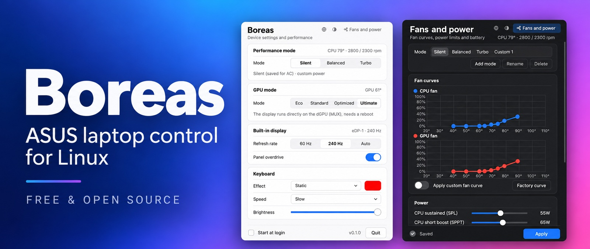
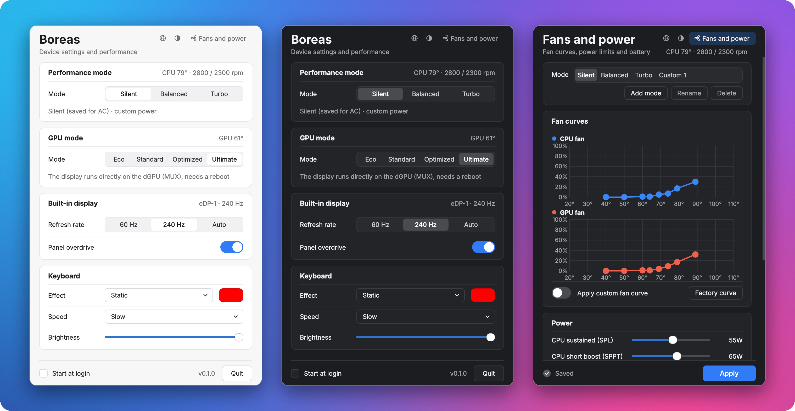

**Linux'ta ASUS ROG ve TUF dizüstüler için fan, CPU, GPU ve pil kontrolü.**

[English](README.md) · **Türkçe**

Boreas, Linux için açık kaynaklı bir Armoury Crate alternatifidir. ASUS ROG ve TUF dizüstülerde performans
modlarını, özel fan eğrilerini, CPU ve GPU güç limitlerini, GPU modlarını (Eco, Optimized ve Ultimate MUX
anahtarı), Aura klavye aydınlatmasını ve pil şarj limitini yönetir.

[asus-linux.org](https://asus-linux.org) topluluğunun çalışması üzerine kuruludur: donanım desteğinin
tamamı onların çekirdek sürücülerinden (asus-wmi, asus-armoury) gelir. Boreas, kullanıcı tarafındaki kısmı
(asusd, supergfxd, rog-control-center) tek bir küçük sistem servisi (`boreasd`) ve bir tepsi uygulamasıyla
(`boreas`) değiştirir.



CachyOS kurulu bir ROG Strix G713PV (kernel 7.3, asus-armoury) üzerinde geliştirildi ve denendi; başka
modellerde ve dağıtımlarda farklı davranabilir.

**Diller:** English, Türkçe, 简体中文, हिन्दी, Español, العربية, Français, Português (Brasil), Русский,
Deutsch, 日本語.

## Özellikler

| Özellik | Boreas | Linux arayüzü |
|---|---|---|
| Sessiz / Dengeli / Turbo | ✓ | `platform_profile` |
| Özel modlar (Özel 1, 2…) | ✓ | aynı tabanda yerleşik moda bağlı |
| Mod başına fan eğrisi | ✓ (CPU, GPU, orta) | `asus_custom_fan_curve` hwmon |
| Güç limitleri (SPL/SPPT/FPPT) | ✓ | asus-armoury `ppt_*` |
| NVIDIA Dynamic Boost / sıcaklık hedefi | ✓ | asus-armoury `nv_*` |
| CPU sıcaklık limiti (75-95 °C, mod başına) | ✓ (Dragon Range, Fire Range) | Ryzen SMU tctl; kernel lockdown kapalı olmalı |
| Pil/prize göre otomatik mod | ✓ | `power_supply` |
| GPU: Eco / Standart / Optimized / Ultimate | ✓ | `dgpu_disable`, `gpu_mux_mode` |
| Ekran 60 Hz / maks / Otomatik | ✓ (KDE) | `kscreen-doctor` |
| Panel overdrive | ✓ | `panel_overdrive` |
| Klavye Aura (statik, nefes, döngü, gökkuşağı, strobe) | ✓ | hidraw, rapor 0x5D (output rapor) |
| Klavye parlaklığı | ✓ | `asus::kbd_backlight` |
| Şarj limiti | ✓ | `charge_control_end_threshold` |
| Fn+F5 / KDE güç profili | ✓ | servis profil değişimini izler, mod ayarlarını yeniden uygular |
| Uykudan dönüşte yeniden uygulama | ✓ | systemd-sleep kancası |

Henüz yok: AniMe/Slash matrix, M4/ROG tuşu ataması (KDE kısayoluna `boreasctl mode next`
bağlanabilir), GPU saat ofsetleri, Ryzen undervolt (Curve Optimizer), çevre birimleri (fare, kulaklık),
fan histerezisi, klavye ışığının uyku/kapanış ayarları (Aura power), prize/pile göre ayrı
klavye parlaklığı, tek seferlik %100 şarj, açılış sesi (`boot_sound`), USB-C şarj modu,
Aura ikinci renk.

## Kurulum

Gereksinimler: systemd kullanan bir dağıtım, asus-wmi / asus-armoury sürücüleri olan bir çekirdek,
Python 3.11+, PySide6 (arayüz için), KDE'de ekran yenileme hızı için `kscreen-doctor` ve Wayland'de keskin
görüntü için Qt'nin Wayland eklentisi. Python ve PySide6'yı dağıtımınızın paket yöneticisiyle kurun
(Arch / CachyOS'ta: `sudo pacman -S --needed python pyside6 qt6-wayland`).

```bash
git clone https://github.com/Yusuf-Yonturk/boreas.git
cd boreas
sudo ./install.sh
```

Kurulum arayüz dilini sorar (Enter = English). Sormadan kurmak için: `sudo BOREAS_LANG=tr ./install.sh`.
Her kullanıcı dili sonradan penceredeki küre düğmesinden değiştirebilir. Çince ve Japonca için
`noto-fonts-cjk`, Hintçe ve Arapça için `noto-fonts` gerekir.

Betik `asusd`, `asus-shutdown` ve `supergfxd`'yi maskeler (aynı sysfs dosyalarına yazıyorlar;
asusd udev kuralıyla her açılışta başlatıldığı için `disable` yetmez), `boreasd`'yi açar.
İlk açılışta servis mevcut şarj limitini, klavye parlaklığını, modu ve GPU modunu benimser;
donanıma hiçbir şey yazmaz.

Geri almak: `sudo ./uninstall.sh` (maskeler kaldırılır, asusd / supergfxd geri açılır).

KDE'de Ayarlar → Güç Yönetimi'nde prize ve pile ayrı güç profili seçiliyse Boreas'ın
"pil/prize göre otomatik mod"uyla çakışır; ikisinden birini kapatın.

## Kullanım

```bash
boreas                 # arayüz (tepsi)
boreasctl status
boreasctl mode turbo   # sessiz | dengeli | turbo | next | prev
boreasctl gpu eco      # eco | standard | optimized | ultimate
boreasctl charge 80
boreasctl cputemp 85   # etkin mod; default = firmware varsayılanı
```

Arayüz sistemin açık/koyu temasını izler; başlıktaki düğme otomatik, açık ve koyu arasında geçer.
Zorlamak için `BOREAS_THEME=light boreas` ya da `dark`. `BOREAS_SCALE=1` arayüz boyutunu değiştirir
(varsayılan `0.78`), `BOREAS_LANG=tr boreas` dili zorlar. Sağ üstteki **Fanlar ve güç** düğmesi aynı pencerede fan eğrileri,
güç limitleri ve pil sayfasını açar; tekrar basınca ana sayfaya döner.

CPU sıcaklık yönetimi yalnız etkin modun limitini korur. Dragon Range için MP1
0x23 sorgusu denenir ([ZenStates-Core kaynakları](https://github.com/irusanov/ZenStates-Core/blob/869b7e82572337e5a673e92230edc92bddf0e44b/Hardware/Smu/Commands/GetSystemConfiguredPowerLimit.cs)).
Sorgunun eski değerden yeni hedefe geçtiği bir yazımda gözlenmeden geri okumaya
güvenilmez: bazı firmware'ler BIOS'un sabit limitini bildirebilir. Doğrulanırsa
servis yaklaşık saniyede bir sorgular, yalnız limit değişmişse tekrar yazar.
Limit duruyorsa sıcaklık aşması yeni yazım tetiklemez.

Geri okuma doğrulanamazsa veya hata verirse sıcaklığa göre yeniden gönderim yapılır:
hedefin 2 °C'den az üzerindeyken 3 sn, 2-4 °C üzerindeyken 2 sn, en az 5 °C
üzerindeyken 1 sn. Sensör okunamazsa 3 sn kullanılır. Servis diğer donanım işlemleriyle
meşgulse süre uzayabilir; bu bir kesin sıcaklık sabitleme garantisi değildir.
Varsayılan seçilince düzenli yazım durur, önceki düşük limit 96 °C'ye döner.

`boreasctl status` içindeki `cpu_temp` alanları:
- `applied`: SMU'nun kabul ettiği son yazım; donanımdan geri okunan limit değildir.
- `reported_limit`: son sorgunun bildirdiği değer; geçerli okuma yoksa `null`.
- `readback_verified`: değerin bir limit değişimini takip ettiği gözlendi mi?
- `control`: `readback` (geri okuma doğrulandı) veya `adaptive` (3/2/1 sn yenileme).
- `readback_error`: sorgu hatası. Sorgu desteği yoksa sıcaklık yazımı çalışmaya devam eder.
- `conflict`: SMU'ya aynı anda yazan ryzenadj süreçlerinin pid'leri (~30 sn'de bir taranır).

`status` içindeki `temp_peak`, servis açıldığından beri görülen en yüksek CPU sıcaklığını
(zaman ve mod ile) verir. CPU 95 °C'ye ya da düşürülmüş limitin 5 °C üstüne çıkınca journal'a
başlangıç ve bitiş satırı (en yüksek değer ve süreyle) yazılır:
`journalctl -u boreasd | grep "high temperature"`.

Mod değişiminde profil yazımı firmware'in sıcaklık limitini sıfırlar. Bu yüzden limit
profilden hemen sonra, fan/güç yazımlarından önce bir kez gönderilir, sonda bir kez daha.
G713PV'de firmware ~3-4 sn sonra limiti bir kez daha sıfırlıyor (tam yükte 85 → 91 °C
sıçrama ölçüldü); bu yüzden mod değişiminden sonraki 10 sn boyunca limit 0,25 sn'de bir
yeniden yazılır.

**ryzenadj ile birlikte kullanmayın.** İkisi aynı SMU posta kutusunu (kök kompleks
0xB8/0xBC) süreçler arası kilit olmadan kullanır: birbirlerinin limitini ezerler ve yazımlar
araya girerse SMU'ya yanlış komut gidebilir. `ryzenadj --tctl-temp` döngüsü çalıştıran bir
servis varsa kapatın (`sudo systemctl disable --now ryzenadj.service`); servis bunu görünce
uyarı gösterir.

Bu geri okuma yöntemi 7845HX üzerinde henüz canlı doğrulanmadı; Fire Range için
geri okuma sorgusu etkin değildir. Yalnız sıcaklık değiştirilince profil/fan/güç
ayarları baştan uygulanmaz.

## Güncelleme

Boreas açıldıktan 10 saniye sonra, ardından günde bir kez GitHub'a bakar; her seferinde yalnızca sürüm
numarasının yazdığı küçük dosyayı indirir. Yeni bir sürüm varsa pencerede **Güncelle · Sürüm notları ·
Gizle** görünür. **Güncelle** son sürümü GitHub'dan indirir, yönetici şifrenizi sorduktan sonra (pkexec)
kurar ve uygulamayı yeniden başlatır. **Sürüm notları** [CHANGELOG.md](CHANGELOG.md) dosyasını açar.

Elle güncellemek için:

```bash
cd boreas
git pull
sudo ./install.sh
```

Ardından pencerede **Çıkış**'a basıp `boreas` ile yeniden açın. Kontrol tepsi menüsünden
(**Güncellemeleri denetle**) ya da `BOREAS_NO_UPDATE_CHECK=1` ile kapatılabilir.

## GPU modları hakkında

- **Ultimate** ↔ diğerleri MUX'u değiştirir, yeniden başlatma gerekir.
- **Eco → Standard** yeniden başlatmadan hemen geçer.
- **Standard → Eco**: dGPU sürücüsü bağlıyken `dgpu_disable` yazılırsa sistem kilitlenebilir. Servis
  önce nvidia-persistenced ve nvidia-powerd'yi durdurur, NVIDIA modüllerini kaldırır ve PCI aygıtını
  çıkarır. dGPU kullanımdaysa (KWin, oyun, CUDA) Eco ertelenir: servis 15 saniyede bir yeniden dener ve
  açılışta ekran yöneticisinden önce uygular. KDE Plasma'da (Wayland) KWin dGPU'yu oturum boyunca açık
  tuttuğu için Eco orada bir sonraki açılışta uygulanır. NVIDIA modülü hiç bırakılmıyorsa yeniden
  başlatmaya kadar tekrar denemez.

## Geliştirme

```bash
python3 -m unittest discover -s tests   # sahte sysfs ağacıyla, root gerekmez
python3 -m boreas.gui.app               # arayüz (servis çalışıyor olmalı)
```

Ayarlar: `/etc/boreas/config.json`. Soket: `/run/boreas.sock` (`wheel` grubu).

Yeni sürüm yayınlamak için `boreas/__init__.py` içindeki `__version__` değerini artırın, [CHANGELOG.md](CHANGELOG.md)
dosyasına bir bölüm ekleyin ve `main`'e gönderin; kurulu kopyalar bir gün içinde güncelleme notunu gösterir.

## Katkıda bulunma

Katkıda bulunmaktan çekinmeyin! Hata bildirimleri, çeviriler ve pull request'ler memnuniyetle
karşılanır; özellikle ROG Strix G713PV dışında bir ASUS laptopunuz varsa. Çalışma adımları, testler ve
yeni dil ekleme için [CONTRIBUTING.tr.md](CONTRIBUTING.tr.md) dosyasına bakın.

## Teşekkürler

- ASUS donanımı üzerine yaptıkları açık kaynak çalışma için Serge'ye ve
  [G-Helper](https://github.com/seerge/g-helper) topluluğuna.
- Linux çekirdek sürücüleri (asus-wmi, asus-armoury) ve asusctl için [asus-linux.org](https://asus-linux.org)
  topluluğuna.
- AMD SMU araştırmaları için [RyzenAdj](https://github.com/FlyGoat/RyzenAdj) ve
  [ZenStates-Core](https://github.com/irusanov/ZenStates-Core) projelerine.

## Lisans

Copyright (C) 2026 Yusuf Yontürk. [GPL-3.0](LICENSE) lisansıyla dağıtılır.

ASUS, ROG, TUF ve Armoury Crate, ASUSTeK Computer Inc.'in ticari markalarıdır; bu proje ASUS ile bağlantılı değildir.
